# UI V4 report

Branch `ui-v4`. Spec: `docs/UI_V4_SPEC.md`. Phases V1 to V5 are done, in order, each with its own gate, commit, push and row in `docs/UI_V4_PROGRESS.md`. Choices are recorded in `DECISIONS.md` as D-205 to D-209 [UI-V4, review]. Nothing was merged or deployed.

**Rules hash:** `b1b485fa65cf3b29` after every phase. No file under `src/engine` or `src/shared/flow.ts` changed (`git diff origin/main -- src/engine src/shared/flow.ts` is empty). Study is untouched, and the golden test passed at every commit.

## What changed, per phase

**V1. No pop-ups** (D-205)
- Play used to have 9 kinds of overlay. Now the menu is the only one.
- A coach mark is now a one-line hint under the thing it explains, shown the first time only. At most one hint shows on a screen.
- Tapping a claim bubble turns that bubble into two buttons, "Call it, 10" and "Cancel".
- Give is a collapsed row. A tap opens the picker in place (who, then 5, 10 or no gift).
- "See the money", "What was really going on?" and the score in words open in the screen's own content area, with a Close button. Your choices underneath are kept.
- The opening card is a screen of its own. From the in-game menu, it opens inside the menu.
- Dash speaks from one fixed slot under the cast.

**V2. A simpler game** (D-206)
- **Verbs unlock one at a time in a life.** Episode 1 has vote and peek only. Claims come in Episode 2, "Call it" in Episode 3, Give in Episode 4. A single episode still has everything.
- Bots still claim, call and give. Their gifts now show as plain lines in the round results ("Ugo gave Marigold 10.").
- **One decision per screen:**
  - Episode 3: a pool member first answers "Keep someone out of the pool?" on its own screen, then "Buy cover this round?". The gym is an optional row.
  - Episode 2: "How hard do you work?", then "What do you tell the table?" on its own screen.
  - The event card is now its own beat before the round's first decision.
- Every decision screen has one question as its headline and at most two lines of help.
- Each episode opens with a "How this episode works" card: three lines and one drawn picture. It is also in the menu. In a life, the card adds one "New:" line naming the verb that unlocks.

**V3. Cause and effect** (D-207)
- Tiles say what happens, in coins. For example: "Buy cover: Pay 61 now. A hit then costs you 0." and "No cover: Keep 61. A hit costs you 220."
- The mission effect is a word: "Helps your mission", "Hurts your mission" or "No effect on your mission".
- Every round result has a "What your choices did" block:
  - one row per decision you made, with its effect;
  - one row for luck;
  - one row for everyone else;
  - one row for pay and living costs.
- The rows add up to the bank change shown, to the coin. An e2e check and `scripts/v4-did-check.mjs` both test this: 56 blocks over 4 lives, 2 to 4 seats, 0 mismatches.
- On the summary, the score change flies into the score bar as labelled pieces ("-32 bank", "-11 mission"). One line says what helped and what hurt most.
- The ranking is a bar race. In a life, other scores are secret except the rounded gaps to your neighbours, so the bars further away show "?".

**V4. Pacing and sound** (D-208)
- **Auto-advance:** only screens of 8 words or fewer move on by themselves. On those, a thin line shows the countdown, and a tap or touch holds the screen. No Play screen is that short today, so every screen now waits for a tap.
- **Reveals:** each item shows for at least 1.5 s, and a reveal takes at most 6 s. A tap skips to the end. With more than four items, the reveal stages an even pick of four, and the end screen shows them all.
- **Sound:**
  - a gain plays a rising major jingle;
  - a loss plays a falling "wah-wah";
  - both get longer as the change gets bigger (under 20, under 80, 80 or more);
  - no change plays a soft tick;
  - being caught and catching a liar each have their own sound;
  - mute is still remembered.

**V5. Three style directions, preview only** (D-209)
- `?styles=1` shows the Episode 3 move and reveal screens, with the full cast and Dash, in three directions side by side. Each direction has a name and two lines of description.
- The fonts are bundled with the site and load only on that page. The page is a separate 5.9 KB chunk; the game never loads it.
- No direction is applied to the game.

## Before and after: 6 key screens

Same life (seed `fresh-life-1`), 375 x 760, reduced motion. Before is commit `d6ffeec`; after is `d52716b`.

| Screen | Before | After |
|---|---|---|
| 1. Episode 1 vote | 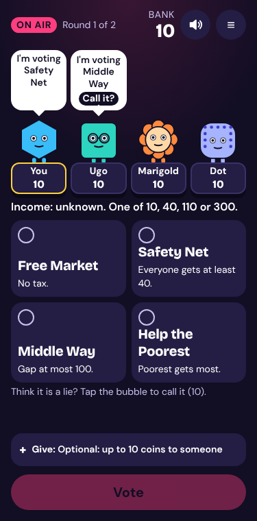 | 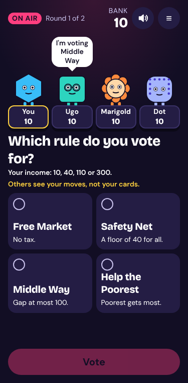 |
| 2. Episode 2 move | 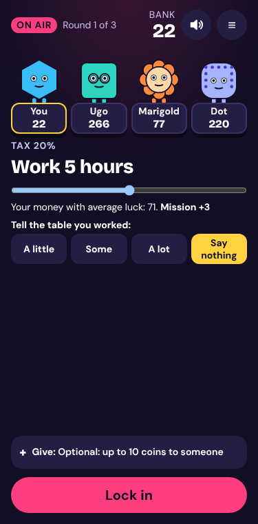 | 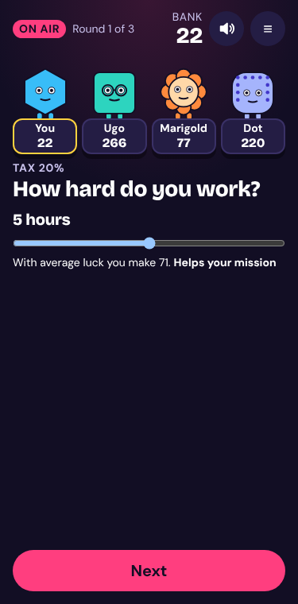 |
| 3. Episode 3 move (launch round) | 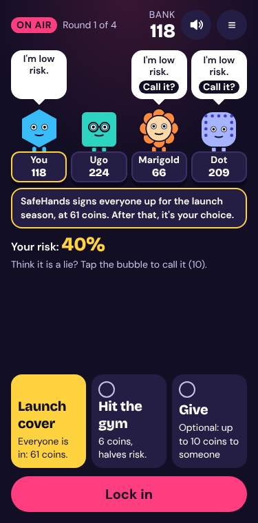 | 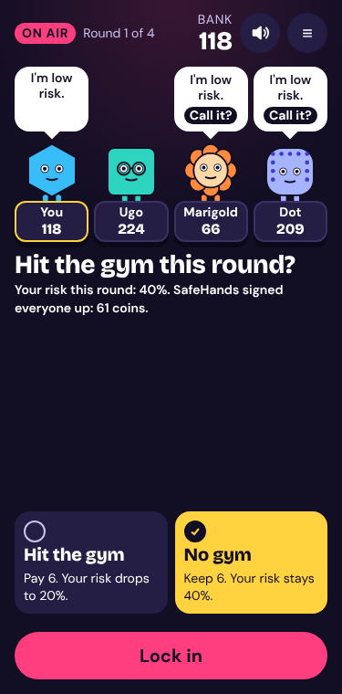 |
| 4. Episode 3 round result | 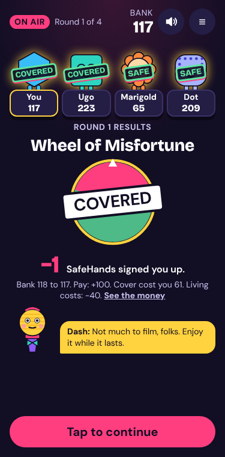 | 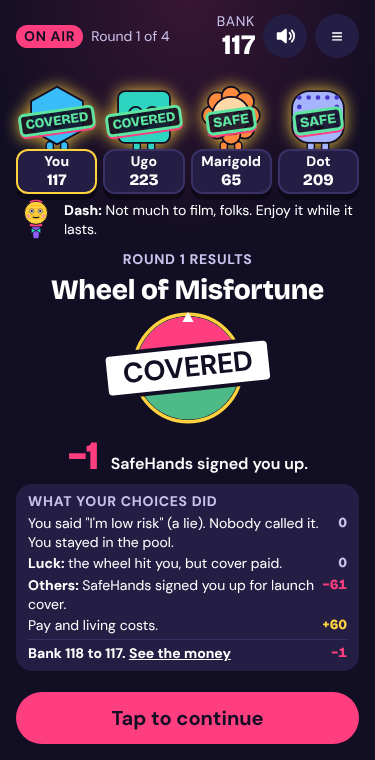 |
| 5. Episode 3 reveal | 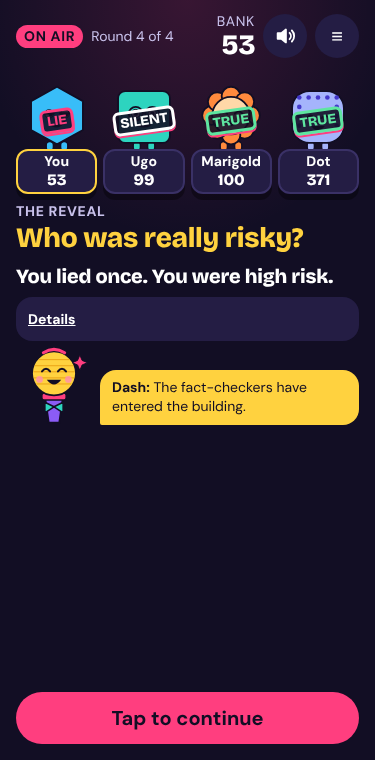 | 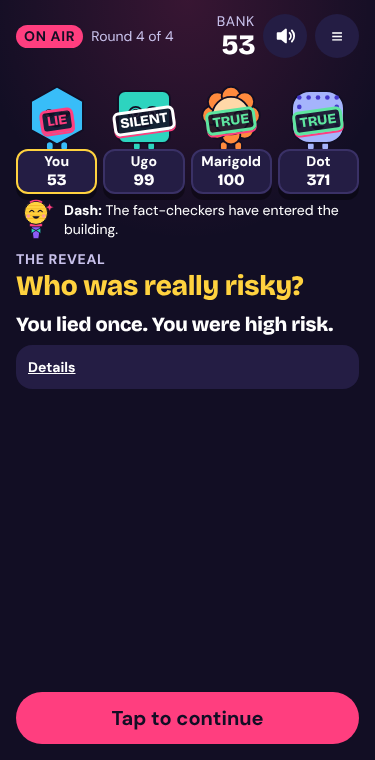 |
| 6. Episode summary | 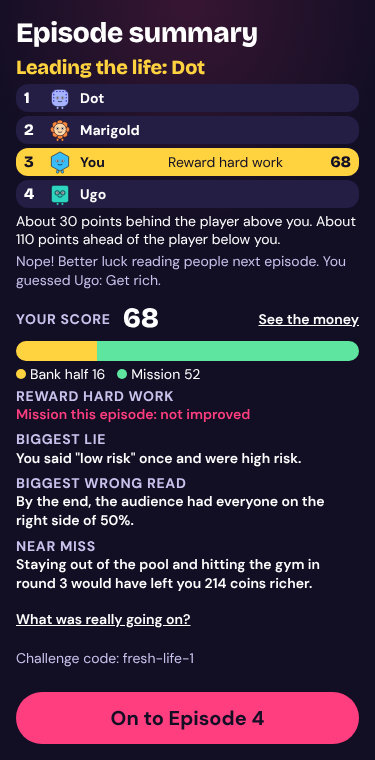 | 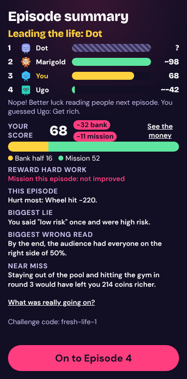 |

More "after" shots are in `docs/review/ui-v4/`:
- the cover question in a later round: `extra-ep3-cover-question.png`
- the bar question: `extra-ep3-bar-question.png`
- the Episode 2 claim question: `extra-ep2-claim-question.png`
- a call inside a bubble: `extra-call-in-bubble.png`
- Give open in place: `extra-give-in-place.png`
- "See the money" open in place: `extra-money-in-place.png`
- the mission screen with the Episode 1 card: `extra-ep1-mission-and-howto.png`
- the Episode 3 card: `extra-ep3-howto.png`

## Words per decision screen, before and after

**How words are counted:** only the words on the screen itself. The top bar, the cast's names, banks and bubbles, and the bottom button are not counted.

**Which runs:**
- The table is one life, seed `fresh-life-1`, 375 x 760, first-time hints off.
- With first-time hints on, the life's maximum is still 44.
- Each single episode, with hints on, has a maximum of 45.
- The second steps of split decisions don't appear in the walkthrough. Measured separately with hints on:
  - the Episode 2 claim question: 40 words;
  - the Episode 3 bar question: 28 words;
  - the cover question that follows it: 38 words.

| | Screens | Max | Mean | Over 45 |
|---|---|---|---|---|
| Before | 40 | 65 | 44.1 | 22 |
| After | 38 | 44 | 29.4 | 0 |

| Screen | Before | After |
|---|---|---|
| Ep1 R1 Fair tax (unpaid) | 24 | 24 |
| Ep1 R1 Claim | 25 | hidden in a life (V2) |
| Ep1 R1 Vote | 53 | 37 |
| Ep1 R2 Peek | 36 | 39 |
| Ep1 R2 Claim | 20 | hidden in a life (V2) |
| Ep1 R2 Vote | 38 | 34 |
| Ep1 Guess a mission | 58 | 24 |
| Ep2 R1 Tax vote | 51 | 31 |
| Ep2 R1 to R3 Hours | 33, 33, 44 | 17, 17, 17 |
| Ep2 R1 to R3 Hustle Prize | 49, 47, 48 | 29, 29, 29 |
| Ep2 Guess a mission | 58 | 24 |
| Ep3 R1 Claim | 32 | 26 |
| Ep3 R1 to R4 Move | 53, 65, 49, 49 | 34, 28, 43, 43 |
| Ep3 R3 Rule for round 4 | 44 | 43 |
| Ep3 Guess a mission | 58 | 24 |
| Ep4 R1 HireBot | 60 | 29 |
| Ep4 R2 to R4 Train | 42, 59, 58 | 33, 35, 37 |
| Ep4 R2 to R4 Claim | 23, 23, 23 | 27, 27, 27 |
| Ep4 R2 HireBot rule | 43 | 44 |
| Ep4 Guess a mission | 58 | 24 |
| Ep5 Rules behind the veil | 46 | 30 |
| Ep5 Fair tax again | 46 | 30 |
| Ep5 Claim | 19 | 19 |
| Ep5 Pay for votes | 33 | 30 |
| Ep5 Changes 1 to 4 | 44, 54, 54, 54 | 24, 28, 28, 28 |
| Ep5 Guess a mission | 58 | 24 |

## Overlays

**Before: 9 kinds.**
1. The coach mark on the first claim (fixed at the top for 7 s).
2. The coach mark on the first move.
3. The coach mark on the first call.
4. The "Call it on X for 10?" confirm box over the stage.
5. The Give sheet.
6. The "See the money" ledger.
7. The "What was really going on?" sheet.
8. The score-in-words sheet.
9. The opening card, a full-screen dialog over "Pick your show" and over the menu.

There were no toasts.

**After: 0, besides the menu.** New e2e checks fail a life if any screen has a dialog, an open in-bubble confirm, or anything fixed with z-index 20 or more that takes taps.

**Kept, and why:**
- The opt-in playtest survey (`?playtest=1`) is still a full-screen form: it is a research tool, not part of play.
- The multiplayer connection banners stay: they report room status.
- Coin flights and flashes stay: they are decoration and take no taps.

## Taps, time, size and checks

**Taps and pace** (one life, seed `fresh-life-1`): 71 taps before; 69 after V2; 98 after V4. The rise is the cost of "wait for a tap" on every screen over 8 words. Pace at the RUNPLAN B.8 rates went from 9.3 to 9.2 min (limit 12).

**Bundle:** main JS went from 263.9 to 272.0 KB gzipped (+8.1). The style preview is a separate 5.9 KB chunk, plus about 190 KB of fonts, loaded only at `?styles=1`.

**Gate at the last commit:**
- typecheck, build, 223 unit tests (golden included; 4 new UI tests);
- 20 e2e tests (new: no overlays, an in-bubble call, verb unlocks, every episode's card, every choice block adding up, long screens waiting, the style page);
- life walkthrough at 375 and 360, and with hints;
- Episode 3 Hard, and single Episodes 1 to 5 with hints.

**Fit and accessibility:** every screen fits with no scroll. axe finds 0 violations (WCAG 2 A and AA) on 66 Play screens of a life, and focus rings show on every element tabbed. The two room-server e2e specs were not run (no wrangler in this run), as in UI V3.

## The three style captures

All three meet AA contrast: axe finds 0 violations on all six frames and on the overview. Every frame fits 375 x 760. Each direction is captured as its move screen and its reveal screen in `docs/review/styles/`; `overview.png` shows them side by side.

- **A. Paper puppets** (`A-move.png`, `A-reveal.png`): cream paper; hand-cut characters with ink edges and soft shadows; Fraunces and Atkinson Hyperlegible; tomato, mustard and teal.
- **B. Retro TV studio** (`B-move.png`, `B-reveal.png`): deep teal and orange, a studio-light glow and film grain; flat puppets with big eyes; Fredoka and Nunito.
- **C. Clean editorial** (`C-move.png`, `C-reveal.png`): light page, black text, one blue accent; line drawings whose posture shows the feeling; Inter throughout.

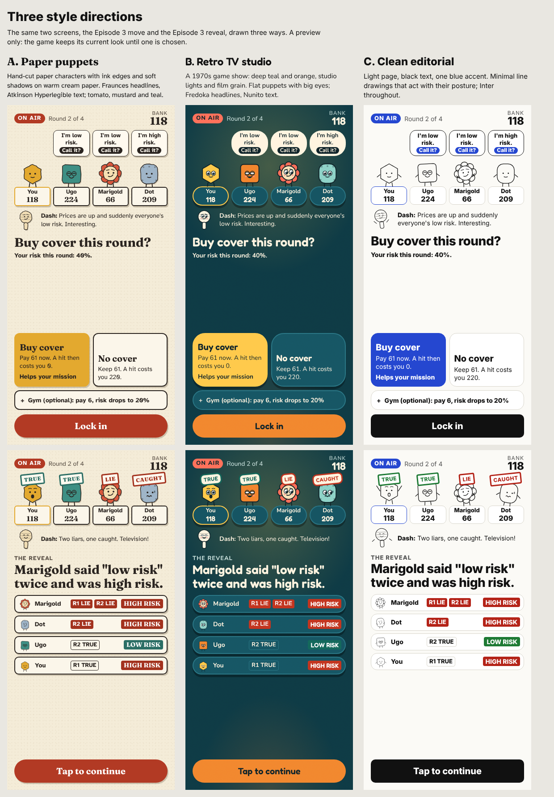

## Anything left

- **Taps.** Taps rose to 98 because nothing moves on by itself any more. Shorter beats (8 words or fewer) or merging beats into the next screen would bring them down.
- **Result screens are still wordy.** These aren't decision screens, so they have no 45-word limit:
  - Episode 4's pay screen runs to about 77 words;
  - the episode summary runs to about 100;
  - Episode 2's income screen still shows its formula in small print.
- **Rank race in a life.** Only the bars next to yours can have lengths; the others show "?", because those scores are secret until the end.
- **Dash's slot.** It holds up to two text lines; longer lines are cut with an ellipsis.
- **Multiplayer rooms.** In a room, a life's Episode 1 claim screen still shows; Call it and Give are hidden there as in solo. This was not tested with the room server.
- **Sounds.** Not listened to by a person.
- **Styles.** No direction is chosen or applied. The preview screens are static mock-ups with fixed numbers.
- **Carried over from UI V3:** the finale lead change is 15.7%, under the 20% target (D-204), and the room server must serve `b1b485fa65cf3b29`.

## Human validation: NOT DONE

No person has played UI V4 or looked at the style directions. Every check here is automated or an AI judgement, not human evidence. Nothing here shows whether people find the game simpler, clearer, calmer or more fun, or which style they prefer.

## Commit and preview

- **Commit:** the last phase commit is `d52716b` on `ui-v4`. This report and its screenshots are committed on top of it.
- **Rules hash:** `b1b485fa65cf3b29`, unchanged.
- **Preview link:** none. This run did not deploy, as instructed. Locally, run `npm run dev` and open `/?styles=1` for the style preview, or the root URL for the game.
