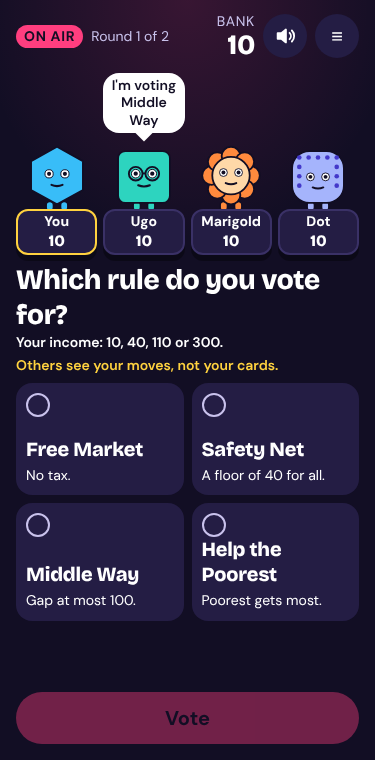
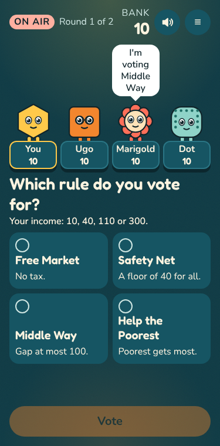
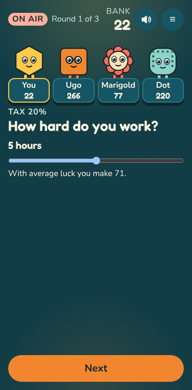
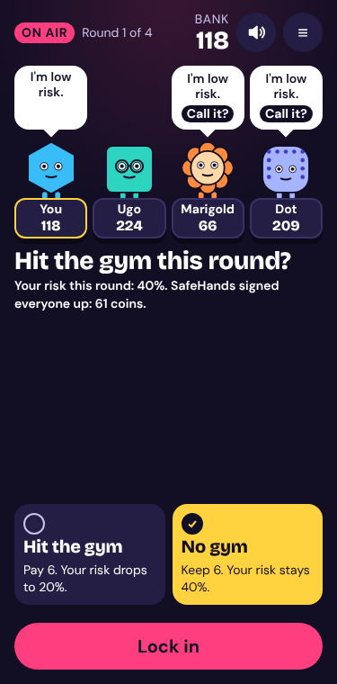
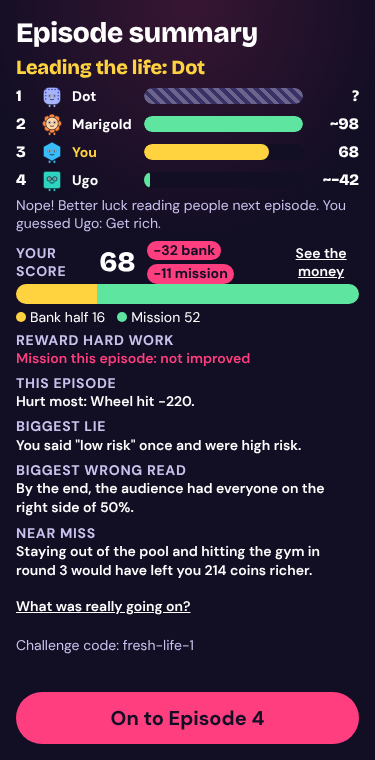
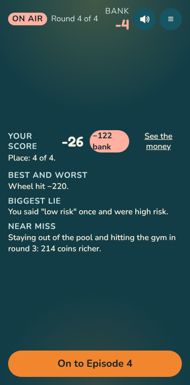

# V5 report

Branch `v5`, made from `ui-v4` at `254be45`. Three phases, done in order, each gated, committed, pushed and logged in `docs/V5_PROGRESS.md`. Choices are recorded in `DECISIONS.md` as D-210 to D-212 [V5, review]. Nothing was merged or deployed. Study is untouched: the golden test passes at every commit.

**New rules hash: `35f3c43191c5b77b`** (was `b1b485fa65cf3b29`). Only N1 changed the engine, in its own commit `4c7fee0`. Merging needs the room server redeployed with this hash first.

## N1. Missions removed (D-210)

**What is gone:** the mission card, mission points, mission previews on tiles, the mission bar, the card guess and the mission reveal. The VALUES_REVEAL and GUESS phases are never queued in Play.

**Scoring:** your score is your bank, plus Second Chance points. In a life the bank still counts from the end of Episode 1, so birth income is not scored, as before (D-203). Debt no longer costs points; it is already a negative bank.

**Bots:** each bot has a fixed values trait that drives its choices exactly as its mission did. Marigold protects the poorest, Ugo grows the total, Dot rewards effort, Chet looks after himself. The traits are never named on screen; they show in what each bot does and in one new line per moment in its own voice. The values deck is still shuffled at setup, so the game stream is unchanged.

**End of life:** one screen, "You played like…".
- It maps your own choices over the life to the four principles by fixed rules, and names you after the bot who carries that trait: "You played like Dot."
- It gives one example ("In Episode 4 you paid to train.") and the share of each principle.
- It compares your first fair-tax answer with your vote: "You said 30% tax was fair, and you voted for 30%."
- The mapping is a judgement, not a measurement.

**Checks:** 1,000 bot lives (these describe the bots, not people). Every E check passes. F-a, F-b, F-d and F-f pass. F-e is dropped.

**Retuning:** life-level knobs only, six sweeps of 300 lives, then 1,000 lives to confirm. The bots' finale values weight went from 2 to 4; nothing else changed.

**Two targets missed:**
- The leader after Episode 4 loses the finale in 13.3% of lives (target 20%; it was already 15.7% and missing).
- The score gap share is 59.8% (target 40%; it was 37.1%).

With the score equal to the bank, the finale's flat tax and floor keep everyone's order. The missions used to reorder the finale. Meeting these targets needs a finale mechanic that reorders banks, which is a rules change.

### The N1 table

| 1,000 bot lives | Before (`b1b485fa65cf3b29`) | After (`35f3c43191c5b77b`) |
|---|---|---|
| E1 peekers vote less redistribution (> 0) | 0.499 ± 0.029 PASS | 0.485 ± 0.026 PASS |
| E2 effort slope on tax (< 0) | -4.435 ± 0.171 PASS | -4.225 ± 0.168 PASS |
| E2 added: overclaimed hours (> 0) | 0.368 ± 0.015 PASS | 0.355 ± 0.015 PASS |
| E3a high- to low-risk applicants (at least 2) | 3.70 PASS | 3.33 PASS |
| E3b round-3 price rise (at least +15%) | +37.0% PASS | +31.9% PASS |
| E3c bars that hit high risk (at least 60%) | 91.0% PASS | 91.1% PASS |
| E3d round-3 pool price (above 0) | 0.334 PASS | 0.294 PASS |
| E4a Circle minus Square gap positive (at least 70%) | 89.6% PASS | 89.4% PASS |
| E4b passing Squares hired complex (at most 10%) | 0.0% PASS | 0.0% PASS |
| E5 fair-answer shift slope (< 0) | -0.069 PASS | -0.048 PASS |
| F-a lead changes per life (at least 2) | 2.88 PASS | 3.22 PASS |
| F-b last after Ep2 finishes 1st or 2nd (at least 20%) | 25.2% PASS | 30.4% PASS |
| F-c top two within 15% (at least 40%; not on the keep list) | 66.4% | 39.3% (miss) |
| F-d a big moment (at least 90%) | 88.4% FAIL | 91.5% PASS |
| F-e mission win shares | 24.8 / 25.3 / 33.1 / 16.9 | dropped |
| Wins by bot trait (no target) | n/a | Chet 31.1%, Marigold 11.3%, Ugo 31.3%, Dot 26.3% |
| F-f someone goes into debt (30% to 70%) | 51.6% PASS | 53.3% PASS |
| U5: final order = order after Ep2 (at most 35%) | 15.2% PASS | 10.7% PASS |
| U5: Ep4 leader loses the finale (at least 20%) | 15.7% (miss) | **13.3% (miss)** |
| Score gap 1st to 4th, share of the winner (at most 40%) | 37.1% PASS | **59.8% (miss)** |
| Born poorest wins (at least 15%) | 21.9% PASS | 38.2% PASS |

### The six sweeps

300 lives each. The two numbers are the finale lead change and the score gap share.

| Sweep | Finale lead change | Gap share | Note |
|---|---|---|---|
| No change | 10.0% | 58.5% | |
| Finale weight 4 | 13.7% | 59.5% | **chosen** |
| Second Chance 200 coins | 9.3% | 53.8% | |
| Weight 4 and 200 coins | 11.7% | 54.3% | |
| Weight 10 and Marigold's scale 3 | 14.7% | 62.0% | |
| As above, whole bank scored | 7.0% | 45.4% | Born poorest wins 10.0%: fails |

## N2. Style B, Retro TV studio, across Play (D-211)

**Stage:**
- Deep teal background with a soft studio-light glow.
- A static film grain at 4% opacity: a noise tile in the background, never animated.
- Orange is the main action colour. It is a new `action` design token, on every main button.

**Type:**
- Fredoka for headlines and Nunito for text, bundled locally (no font CDN).
- No Play text is under 16 px. The a11y script now lists any such text: 0 on every Play screen, the menu, and the mode and setup pages. Stamps are the only exception (14 px capitals on cream).

**Characters:**
- Flat puppets with thick outlines and big expressive eyes.
- All six expressions for every contestant, Dash's four, and the six shapes in the avatar picker.
- Stamps are cream cards.
- The wheel, the win and loss flashes and the result card use the same tokens.

**Contrast:** the negative colour is a lighter coral than the preview used, so negative numbers on cards pass AA.

**What else changed:**
- Study keeps its look.
- The `?styles=1` preview page, its script, its test and three unused font packages were removed. The captures stay in `docs/review/styles/`.

## N3. Fewer taps, shorter results (D-212)

**Results carried over:** before an episode's last round, the round's "What your choices did" block shows at the top of the next round's first decision, as "Last round", one line per row. It carries the round's other news as a line:
- the new price of cover;
- the big vote's result;
- who won the Hustle Prize;
- the new HireBot rule.

**Screens folded in:**
- Episode 1's vote result and incomes are now one screen; the unborn beat is gone.
- Episode 2's incomes are one line on the prize vote, and the tax beat is gone.
- Episode 3's Bar result is a line on the wheel; its price board and vote beat moved into the carried block.
- Episode 4's belief board and policy beat are gone.
- In a life, Episode 5's incomes screen is one line on the next question.

**Auto-advance:** no screen over 8 words moves on by itself. The folded engine screens show nothing at all.

**Summary:** at most 50 words (37 to 46 measured). It has:
- the score and its change, and your place;
- the best and worst money line of the episode;
- the biggest lie;
- the near miss.

"What was really going on?" moved into the menu.

**Episode 4's pay screen:** at most 45 words (11 to 43 measured).

**Episode 2's income formula:** it is on no screen now, only behind "See the money".

**Fixed along the way:** an unfilled "{c}" on Episode 1's "Stay blind" tile, there since UI V4. e2e now fails on any unfilled placeholder.

## Taps and words

Seed `fresh-life-1`, 375 x 760. Before is end of UI V4 (`254be45`); after is end of V5 (`2e86b33`). The "before" summary and pay word counts are from the UI V4 V3 walkthrough of the same seed; V4 did not change those screens.

| | Before | After N1 | After N3 |
|---|---|---|---|
| Taps in a life | 98 | 94 | **73** (72 to 75 over five seeds) |
| Pace (RUNPLAN B.8 rates) | 9.2 min | 8.8 min | 7.5 min |
| Decision screens: max words, mean, over 45 | 44, 29.4, 0 | 45, 29.7, 0 | 45, 29.5, 0 (the carried block counted apart) |
| Episode summary words | 87 to 117 | 60 to 89 | **37 to 46** (limit 50) |
| Episode 4 pay screen words, last round | 80 | 83 | **43** (limit 45) |
| Screens auto-advancing over 8 words | 0 | 0 | 0 |

**Size:** main JS is 265.2 KB gzipped (was 266.3 at the end of UI V4).

**Gate at the last commit:**
- 223 unit tests, the golden test included;
- 18 e2e tests;
- the life walkthrough at 375 and 360, and with first-time hints;
- Episode 3 on Hard, and single Episodes 1 to 5 with hints;
- axe: 0 violations;
- the "choices add up" check: 56 blocks, 0 mismatches.

The two room-server e2e specs were not run (no wrangler in this run).

## Before and after: 6 key screens

Before: end of UI V4. After: end of V5 (style B, no missions, N3 layout). Same life, seed `fresh-life-1`.

| Screen | Before | After |
|---|---|---|
| 1. Episode 1 vote |  |  |
| 2. Episode 2 move |  |  |
| 3. Episode 3 move |  |  |
| 4. Episode 3 round result |  |  |
| 5. Episode 3 reveal |  |  |
| 6. Episode summary |  |  |

More shots are in `docs/review/v5/`:
- "You played like…": `extra-you-played-like.png`
- the result card: `extra-result-card.png`
- a carried result on the next screen: `extra-carried-result-ep1-peek.png`
- Episode 4's pay screen: `extra-ep4-pay.png`
- an event card: `extra-ep3-event.png`

## What's left

- **Finale targets (N1).** The leader after Episode 4 loses the finale in 13.3% of lives (target 20%), and the score gap share is 59.8% (target 40%). F-c is 39.3% (target 40%; not on the keep list). Reaching these needs a finale rule that can reorder banks, which is an engine change for the owner to decide.
- **"You played like…".** The mapping from choices to principles is a judgement; review it.
- **Worrier card.** It no longer costs the human anything, because debt points are gone. It still drives bots and colours claims.
- **Second Chance.** The points option (40) is now clearly worse than the coins (120); every bot takes the coins.
- **Taps.** A life is at 72 to 75 taps over five seeds, so a long one can land exactly on 75.
- **Summary.** The ranking bars left the summary to stay under 50 words; only your place remains, and the screen now has a lot of empty space.
- **Rooms.** Multiplayer rooms keep the folded screens (the incomes and prize screens), and were not tested against the room server.
- **Not seen or heard by a person:** the new look's fonts, grain and characters, and the sounds from UI V4.

## Human validation: NOT DONE

No person has played V5. Every number here comes from bots or automated checks. Every review is an AI judgement, not human evidence. Nothing here shows whether people find the game clearer, calmer or more fun without missions or in the new look.

## Commit and preview

- **Commits on `v5`:**
  - `4c7fee0`: N1, engine and UI, rules hash `35f3c43191c5b77b`
  - `34f5538`: N2
  - `2e86b33`: N3
- This report is committed on top of them.
- **Rules hash the room server must serve:** `35f3c43191c5b77b`.
- **Preview link:** none. This run did not deploy, as instructed.
