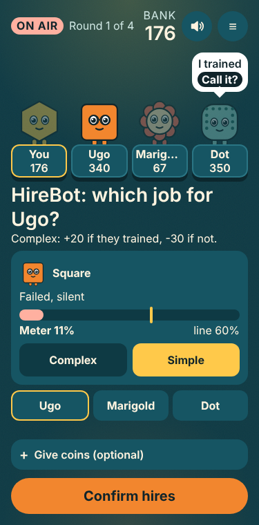
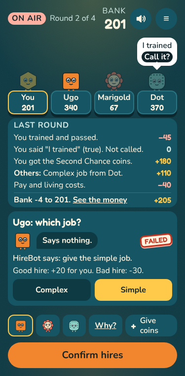
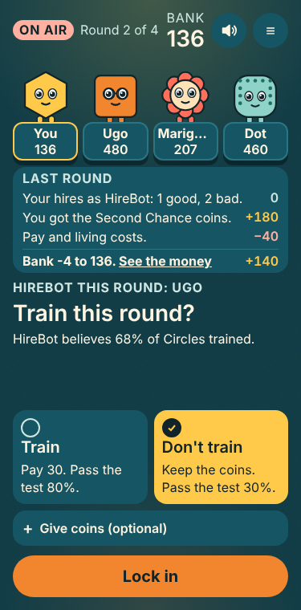
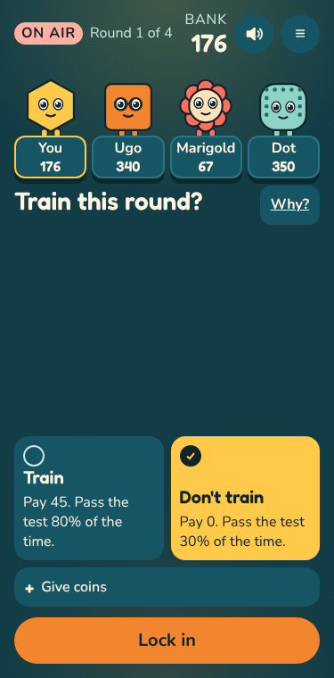
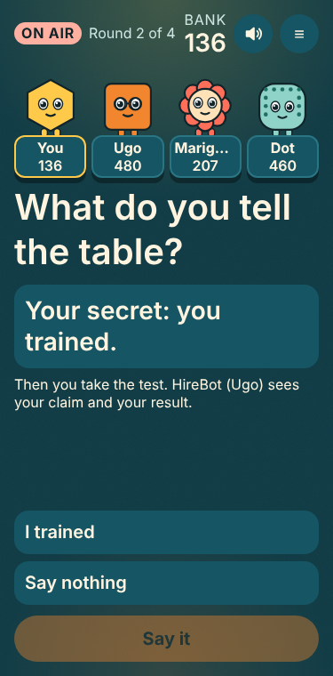
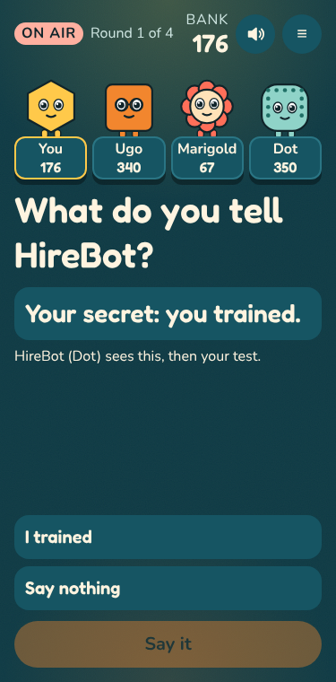
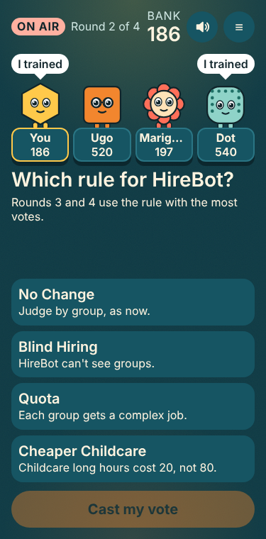
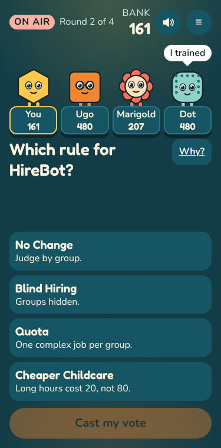

# V6 report

Branch `v6`, made from `main` at `dd7c29d`. Four parts, done in order. Each part was gated, committed and pushed. Choices are recorded in `DECISIONS.md` as D-217 to D-220 [V6, review]. Nothing was merged or deployed. Study is untouched: the golden test passes at every commit.

**New rules hash: `0e8c5a95cc6f7010`** (was `b43294bd2727aac5`). Only part 1 changed the engine, in its own commit (`c2446b1`). Parts 2 to 4 are presentation or simulator only. Merging needs the room server redeployed with this hash first.

Every simulator number here comes from bots. These numbers describe the bots, not people.

## 1. Episode 4 judge seats (D-217)

**Problem.** `judgeOf` took seats in order from seat 1 for 4 rounds. At 3 seats, seat 1 was HireBot twice and the others once. At 4 seats, the seats that judged before the policy vote also did better.

**Change.**
- Rounds by seat count: 3 rounds at 3 seats; 4 at 2 and 4 seats (`PLAY.L4.ROUNDS_BY_SEATS`).
- The seat that judges round 1 is drawn on the game stream. The order then goes round the table.
- The policy vote stays after round 2. At 3 seats the chosen rule runs one round; the vote's "Why?" says so.
- The view lists every round's judge. The "Your card" beat shows that order (it used to assume seat order).

### Final bank by seat, Episode 4 alone

Mean bank ± bootstrap SE. The number in brackets is the seat's distance from the mean over all seats.

**10,000 bot games per seat count, seeds `v6x`:**

| Seats | Before (`b43294bd2727aac5`) | After (`0e8c5a95cc6f7010`) | Every seat within 1 SE |
|---|---|---|---|
| 2 | 145.4 ± 0.8 (+0.0), 145.4 ± 0.8 (-0.0) | 145.6 ± 0.7 (+0.6), 144.4 ± 0.8 (-0.6) | before yes, after **yes** |
| 3 | 153.5 ± 0.8 (-17.9), 190.7 ± 1.2 (+19.3), 170.0 ± 1.1 (-1.4) | 126.5 ± 0.9 (-0.7), 127.9 ± 0.8 (+0.8), 127.0 ± 0.8 (-0.1) | before no, after **yes** |
| 4 | 195.4 ± 1.0 (+3.6), 195.3 ± 1.1 (+3.5), 189.0 ± 1.0 (-2.8), 187.5 ± 1.1 (-4.3) | 191.0 ± 1.0 (-0.6), 192.3 ± 1.1 (+0.7), 191.7 ± 1.1 (+0.1), 191.4 ± 1.2 (-0.2) | before no, after **yes** |

**2,000 bot games per seat count, seeds `v6`:**

| Seats | Before | After | Every seat within 1 SE |
|---|---|---|---|
| 2 | 144.5 ± 1.6 (-0.8), 146.2 ± 1.7 (+0.8) | 143.4 ± 1.7 (-2.0), 147.5 ± 1.6 (+2.0) | before yes, after **no** (by 0.3) |
| 3 | 150.1 ± 2.0 (-22.4), 194.5 ± 2.4 (+22.0), 172.9 ± 2.4 (+0.4) | 124.7 ± 1.8 (-3.4), 128.4 ± 1.8 (+0.3), 131.2 ± 1.9 (+3.1) | before no, after **no** (by 1.6) |
| 4 | 194.1 ± 2.6 (+2.1), 194.2 ± 2.3 (+2.2), 188.0 ± 2.4 (-3.9), 191.5 ± 2.5 (-0.4) | 191.9 ± 2.5 (-0.9), 192.2 ± 2.5 (-0.6), 193.1 ± 2.4 (+0.3), 194.1 ± 2.3 (+1.3) | before no, after **yes** |

**How to read the 2,000-game misses (medium confidence).** After the change no seat has any structural advantage: every seat judges equally often, and who judges first is random. Then each seat's deviation is pure sampling noise, and a 1-SE band is missed by chance quite often (for one seat, about 1 time in 4). On 10,000 games with other seeds every seat is within 1 SE, the largest gap is 0.8 coins, and the 2-seat sign flips. The before effect at 3 seats (about 20 coins) does not shrink with more games; the after gaps do. A residual seat effect larger than about 1 coin is ruled out by the 10,000-game run. The 2,000-game result still misses the stated test, so it is listed under "What's left".

**At 3 seats** the mean Episode 4 bank falls from 172 to 127 (one round fewer).

### Episode 4 checks before and after (2,000 games, seeds `v6`)

| | 2 seats before / after | 3 seats before / after | 4 seats before / after |
|---|---|---|---|
| E4a Circle minus Square gap positive (at least 70%) | 78.3% / 80.2% | 88.3% / 85.7% | 92.5% / 89.6% |
| E4b passing Squares hired complex, round 1 (at most 10%) | 0.0% / 0.0% | 0.0% / 0.0% | 0.0% / 0.0% |

All pass.

## 2. Episode 4, less to think about (D-218)

**HireBot screen.** One worker at a time:
- the worker's name, face and claim bubble ("“I trained.”" or "Says nothing.");
- the test as a cream stamp, PASSED or FAILED;
- HireBot's suggestion in one line: "HireBot says: hire for the complex job." or "HireBot says: give the simple job.". It comes from the meter and the hiring line, as the bot judges decide.

Above the two jobs, what a hire means for the judge in coins: "Good hire: +20 for you. Bad hire: -30.". The loss is read from the round's hiring line, so an event that changes it shows.

**Behind "Why?":** the worker's group, HireBot's belief about that group, and the meter with its line. "Why?" replaces the worker card until "Back", so the screen never grows. On Hard there is no suggestion (the meter is hidden there, D-145), and "Why?" says so.

**Layout.** The worker tabs are faces. They share the bottom row with "Why?" and the gift. A call shows as "Calling Ugo (10).".

**Train screen.** One question, "Train this round?", with two tiles:
- Train: "Pay 12. Pass the test 80% of the time."
- Don't train: "Pay 0. Pass the test 30% of the time."

Who judges, HireBot's belief and the childcare line are behind "Why?".

**Claim screen:** "What do you tell HireBot?" and "HireBot (Ugo) sees this, then your test."

**Policy vote:** one short line per rule. Which rounds the rule covers, and a longer line per rule, are behind "Why?".

### Words on Episode 4 decision screens

The screen's own words, not counting the carried "Last round" block (counted apart, as in V5).

| Screen | Before (main, `fresh-life-1`, 375 x 760) | After |
|---|---|---|
| HireBot | 29 | 25 to 26 |
| Train | 33 to 37 | 27 |
| Claim | 27 | 20 to 21 (29 with the first-time hint) |
| Policy vote | 44 | 28 |
| Limit | none | **30, checked in the life e2e** |

Single Episode 4 walkthroughs at 2, 3 and 4 seats, on Hard, with first-time hints, and at 360 px: 19 to 29 words on every decision screen, and no screen taller than the viewport.

**One fit problem caused by part 1, fixed by part 2.** With a random starting judge, the human can be HireBot in round 2, under the carried block. The old judge screen overflowed 360 x 760 there by up to 116 px (today's Daily Life seed). The new layout fits on every seed tried.

**Engine unchanged in part 2**, so every E4 check is as in part 1.

Screens, before and after (seed `fresh-life-1`, 375 x 760):

| Screen | Before | After |
|---|---|---|
| HireBot |  |  |
| Train |  |  |
| Claim |  |  |
| Policy vote |  |  |

The judge order on "Your card" is in `review/v6/6-judge-order-after.png`.

## 3. Episode 3 dry runs (D-219)

2,000 bot games, 4 seats, Normal, seeds `v6e3`, rules `0e8c5a95cc6f7010`:

| | Value | Target |
|---|---|---|
| Episodes where nobody is hit | **4.0% ± 0.4** | at most 10% |
| Episodes where seat 1 (the human's seat) is never hit | **46.6% ± 1.1** | reported |

Nobody is hit in fewer than 10% of episodes, so **no PLAY value was changed**: the wheel odds stay 10% and 40%, and the gym still halves the risk. No hit is forced. The before and after tables are therefore the same:

| 2,000 games | Before and after |
|---|---|
| E3a high- to low-risk applicants (at least 2) | 4.16 ± 0.18 PASS |
| E3b round-3 price rise (at least +15%) | +34.7% ± 0.9 PASS |
| E3c bars that hit high risk (at least 60%) | 88.7% ± 1.0 PASS |
| E3d round-3 pool price (above 0) | +46.7% ± 2.0 PASS |
| F-f someone goes into debt (30% to 70%) | 32.3% ± 1.0 PASS |

**Caveats:**
- Seat 1 is a bot here. A person may buy cover or use the gym more or less often than this bot does.
- In a life the loss is 220, not 140, so choices differ. The no-hit share inside a life was not measured.

The new lines are printed by `npm run sim -- --ruleset PLAY --episode 3`.

## 4. Optional challenges (D-220)

**The offer.** At the start of a life, before Episode 1's "How this episode works", "Pick a challenge?" offers three challenges out of twelve. Pick one ("Take it") or "Skip". The three are drawn from the seed, so Daily Life offers everyone the same three. It is not shown in multiplayer rooms.

**The challenges.** Bot rate is how often a bot in seat 1 met the challenge, over 300 lives (bots, not people).

| Challenge | Done when | Bot rate |
|---|---|---|
| Stay out of debt | never end a round in debt | 82% |
| Catch two bluffs | call it right on two lies | 0% (bots rarely call) |
| Win without help | finish first without the Second Chance coins | 22% |
| Nobody goes under | the poorest contestant is above 50 at the end of every episode | 17% |
| Honest all the way | never lie in a claim | 28% |
| No peeking | never peek in Episode 1 | 85% |
| Sharp HireBot | no bad hire as HireBot | 89% |
| Open hand | give away at least 20 coins in Episode 4 | 15% |
| Hustler | win a Hustle Prize in Episode 2 | 41% |
| Go it alone | never apply for cover in Episode 3 | 53% |
| Podium | finish first or second | 51% |
| Always training | train every round you work in Episode 4 | 33% |

**At the end.** A challenge never touches the engine or the score. It shows as "Challenge: Honest all the way. Done." (or "Not done.") in two places:
- on "You played like...";
- on the result card, including its shared image.

**How it is built.**
- The checks read only public end-of-life facts, the way the achievements do: `src/ui/play/challenges.ts`, next to `retention.ts`.
- The challenges are their own list, because an achievement is earned without choosing, and a challenge is chosen first.
- The pick is kept per seed, in memory and on the device. A new game clears it.

**One change from the brief.** "Finish without debt" became "never end a round in debt". The finale's floor lifts every debt, so finishing out of debt held in 100% of bot lives.

**Cost:** one more tap at the start of a life.

Screen: `review/v6/5-challenge-offer.png`.

## Whole-life checks, 1,000 bot lives

| 1,000 bot lives, seeds `v6life` | Before (`b43294bd2727aac5`) | After (`0e8c5a95cc6f7010`) |
|---|---|---|
| E1 peekers vote less redistribution (> 0) | 0.559 ± 0.026 PASS | 0.559 ± 0.026 PASS |
| E2 effort slope on tax (< 0) | -4.345 ± 0.153 PASS | -4.345 ± 0.153 PASS |
| E2 added: overclaimed hours (> 0) | 0.348 ± 0.016 PASS | 0.348 ± 0.016 PASS |
| E3a high- to low-risk applicants (at least 2) | 3.65 PASS | 3.65 PASS |
| E3b round-3 price rise (at least +15%) | +38.6% PASS | +38.6% PASS |
| E3c bars that hit high risk (at least 60%) | 90.2% PASS | 90.2% PASS |
| E3d round-3 pool price (above 0) | 0.391 PASS | 0.391 PASS |
| E4a Circle minus Square gap positive (at least 70%) | 89.8% PASS | 90.5% PASS |
| E4b passing Squares hired complex (at most 10%) | 0.0% PASS | 0.0% PASS |
| E5 fair-answer shift slope (< 0) | -0.039 PASS | -0.040 PASS |
| F-a lead changes per life (at least 2) | 3.32 PASS | 3.31 PASS |
| F-b last after Ep2 finishes 1st or 2nd (at least 20%) | 34.6% PASS | 36.0% PASS |
| F-c top two within 15% (at least 40%) | 56.1% PASS | 59.6% PASS |
| F-d a big moment (at least 90%) | 95.2% PASS | 95.2% PASS |
| F-f someone goes into debt (30% to 70%) | 53.2% PASS | 53.1% PASS |
| Wins by bot trait (no target) | Chet 30.0%, Marigold 11.6%, Ugo 31.5%, Dot 26.9% | Chet 26.8%, Marigold 12.7%, Ugo 35.4%, Dot 25.1% |
| Final bank by seat over a life (reported) | 480.3, 493.4, 479.3, 478.4 (SE about 5) | 475.4, 490.2, 478.8, 482.3 (SE about 5) |

Episodes 1 to 3 did not change, so E1 to E3 are identical.

The life bank by seat still has seat 2 high, but within 2 SE. Part 1 only covers Episode 4, and nothing else in a life depends on seat order. Treat it as noise, low confidence.

## Taps and pace

Seed `fresh-life-1`, 375 x 760, from the walkthrough:
- **72 taps in a life** (10, 14, 15, 17, 16 by episode). The walkthrough skips the challenge offer, which counts as one of those taps.
- **Pace: 7.4 minutes.**
- Decision screens: 33, at most 43 words (the Episode 4 ones at most 27).

V5 reported 74 taps on this seed. The difference comes from Episode 4's seat order changing which beats the human sees.

## Gate at the last commit

- Rules hash check, typecheck, build.
- 228 unit tests, the golden test included. New: judge rotation, and the challenges.
- 18 e2e tests. The life spec now also checks:
  - Episode 4 decision screens have at most 30 words;
  - the challenge is offered, taken, and shown on "You played like..." and on the result card.
- Life walkthroughs at 375 and 360, with first-time hints, on `fresh-life-1`, `fresh-life-3` and the Daily Life seeds of 18 and 19 November.
- Episode 3 on Hard.
- Single Episode 4 at 2, 3 and 4 seats, on Hard and with hints.
- axe: 0 violations on 55 screens. Text under 16 px: 0 (the new test stamp is a stamp, like the cast's).
- The two room-server e2e specs were not run (`PW_NO_ROOM=1`; no wrangler in this run). e2e ran with `PW_EXECUTABLE=/opt/pw-browsers/chromium`, because the pinned Playwright's browser is not installed here.

## What's left

- **Seat banks on 2,000 games.** At 2 and 3 seats, one seat is outside 1 SE (by 0.3 and 1.6 coins). On 10,000 games every seat is within 1 SE. I read this as noise; a 1-SE band per seat is a strict test for seats that are equal by design.
- **3 seats.** The chosen HireBot rule now runs only one round (round 3). An alternative is the vote after round 1, so the rule runs two rounds; that is a design choice for the owner.
- **HireBot's suggestion is the bots' own rule**, from the meter. A player who follows it plays like a bot judge. That was the point of making it simple, but it also makes the decision easy to hand over.
- **Hard has no suggestion.** The Hard HireBot screen shows face, claim and stamp only.
- **"Catch two bluffs"** is never met by bots (they rarely call). Its rate for people is unknown.
- **Challenges** are kept on the device. A private window can lose the pick on reload; the life then shows no challenge.
- **Episode 3 inside a life.** The no-hit share was not measured there.

## Human validation: NOT DONE

No person has played V6. Every number here comes from bots or automated checks. Every review is an AI judgement, not human evidence. Nothing here shows whether people find Episode 4 easier, whether the HireBot suggestion is trusted or ignored, or whether anyone wants the challenges.

## Commits on `v6`

- `c2446b1`: part 1, engine (rules hash `0e8c5a95cc6f7010`)
- `4cdd61a`: part 1 UI and part 2. The judge order on "Your card" and the compact HireBot screen had to ship together, because part 1 made the old HireBot screen overflow.
- `86ac9b1`: part 3, the measurement, no tuning
- `6d35e67`: part 4
- this report and the screenshots

**Rules hash the room server must serve:** `0e8c5a95cc6f7010`.

**Preview link:** none. This run did not deploy, as instructed.
