# UI V3 review loop (U4): AI reviewers, a proxy, not human evidence

Two fresh AI reviewers per cycle who had not seen the code or the spec: a mobile game UI designer and a casual first-time player. Each got the BEFORE screenshots (`docs/playtest/shots/life-careful`, a full life with reduced motion, before UI V3) and the AFTER screenshots of that cycle: a full life with motion on, seed `fresh-life-1`, 375 x 760, including mid-animation frames of every reveal; Episode 3 on Hard, seed `fresh-ep3-hard`; from cycle 3 also the Bar with a barred contestant (seed `bar-0`). AFTER captures: `scripts/capture.mjs`; the final ones are in `docs/review/ui-v3/after-life` and `docs/review/ui-v3/after-ep3-hard`. The AFTER runs are played by a script, which can submit a choice different from the one shown selected; reviewers were told this from cycle 3.

## Verdicts on the nine problems in "Why"

| # | Problem | Cycle 1 (designer / player) | Cycle 2 | Cycle 3 |
|---|---|---|---|---|
| 1 | No faces | Fixed / Fixed | Fixed / Fixed | Fixed / Fixed |
| 2 | One graphic | Improved / Fixed | Improved / Fixed | Fixed / Fixed |
| 3 | No sound | Can't tell (mute button seen) | Can't tell / Better | Improved / Can't tell |
| 4 | Almost no motion | Improved / Better | Improved / Fixed | Improved / Fixed |
| 5 | Win and loss alike | Improved / Better | Improved / Fixed | Improved / Fixed |
| 6 | Taps | Improved / Not fixed | Improved / Fixed | Improved / Fixed |
| 7 | Formulas as headlines | Not fixed / Better | Improved / Better | Improved / Better |
| 8 | Half-empty screens | Not fixed / Not fixed | Not fixed / Better | Not fixed / Better |
| 9 | Decimals | Fixed / Fixed | Fixed / Fixed | Fixed / Fixed |

## Five-second test (from the first screen alone)

- **Before:** "a quiz or productivity app", "a form", "can't tell what kind of game this is" (every reviewer, every cycle).
- **After:** "a casual party game show with a cast", "a cute game show about money and fairness where you can lie" (every reviewer). The objection that stayed: the first card still carries three short paragraphs.

## The owner's seven points (cycles 2 and 3)

| Point | Cycle 2 | Cycle 3 |
|---|---|---|
| P1 no raw copy keys; Episode 5 bubbles show claims | Pass / Pass | Pass / Pass |
| P2 GOOD HIRE / BAD HIRE stamps fit their podium | Pass (table badges still long) / Pass | Pass / Pass |
| P3 stamps + one headline, table behind Details | Partial / Pass | Fail (Episodes 3 and 4 had no headline) / Mostly |
| P4 Bar on stage, BARRED, vote marks | Not captured / Not captured | Pass / Pass |
| P5 vivid Dash | Mostly / Partly (small) | Pass (borderline) / Pass |
| P6 launch tile at most 8 words, banner | Pass / Pass | Pass / Pass |

After cycle 3, every peak got a result headline (P3); these last fixes were not reviewed again.

## Fixed per cycle

- **Cycle 1** (D-198): the Episode 5 raw-key bubbles; short stamps that shrink to fit; peak tables behind Details; the Bar on stage; a vivid Dash; the short launch tile; coach marks once each; duplicate HireBot line; vote list labels; "1 prizes"; repeated ballots title; Episode 1 outcome headline. The e2e tests now fail on any raw `play.` key and on any stamp wider than its podium.
- **Cycle 2** (D-199): hire badges match the stamps; Dash at 76 px; debt crack off the text; coach marks off the choices; the top bar stays on the wheel, the Bar and the Receipts; distinct win and loss result cards.
- **Cycle 3** (D-200): a result headline on every peak; SILENT stamps; stamps below the faces; signed bank half on the score bar; "1 lie"; "The wheel is turning..." placeholder.

## Stop

The rule is two cycles in a row with nothing high-impact, or 6 cycles. The loop stopped after 3 cycles because the session's budget ran short. High items still raised in cycle 3: the round money still reads as arithmetic in small print under results; reveal and Bar screens leave space below the spotlight; the coach mark sits over the top bar for 7 seconds; the result card's "Nobody bought it" can disagree with the Receipts.

## Eight key screens, before and after

| Screen | Before | After |
|---|---|---|
| First screen | 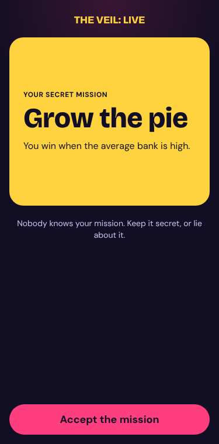 | 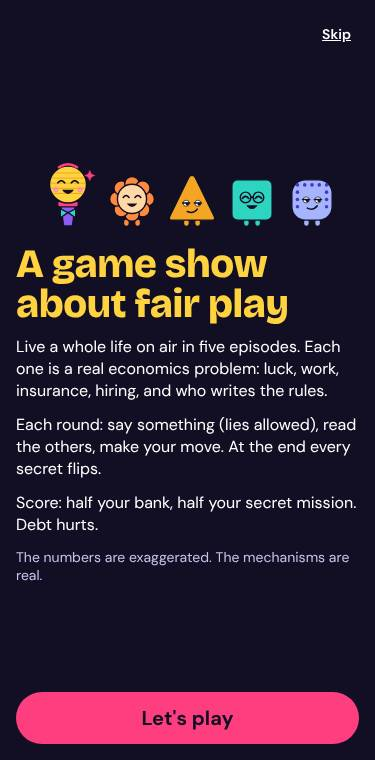 |
| Episode 1 vote (claims as bubbles, Call it) |  | 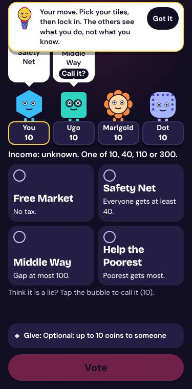 |
| Episode 1 peak (mid-reveal, then end) | 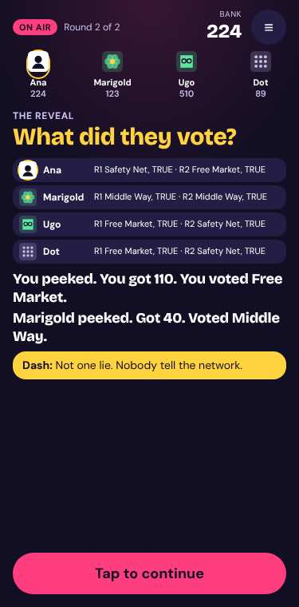 | 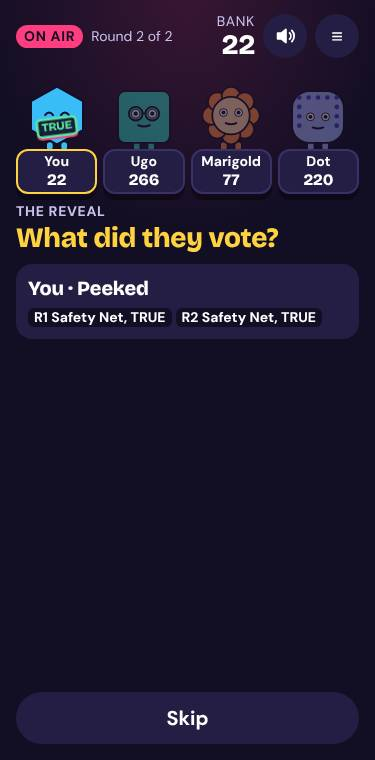 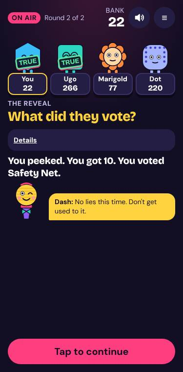 |
| Episode summary | 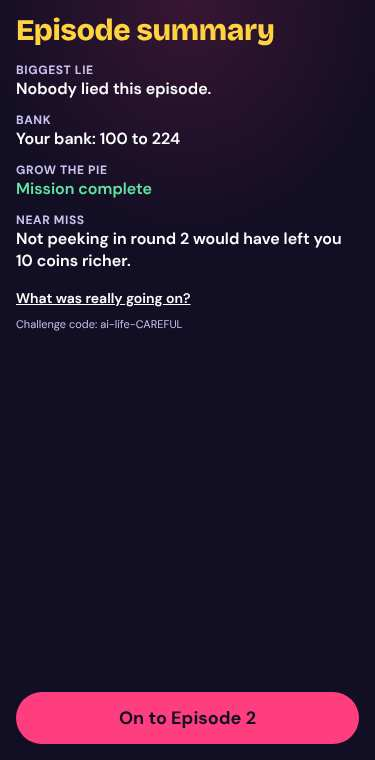 | 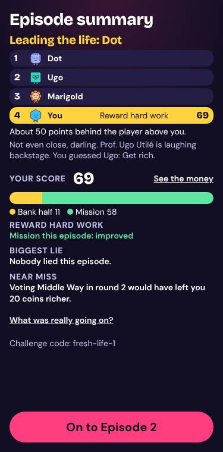 |
| Episode 3 move | 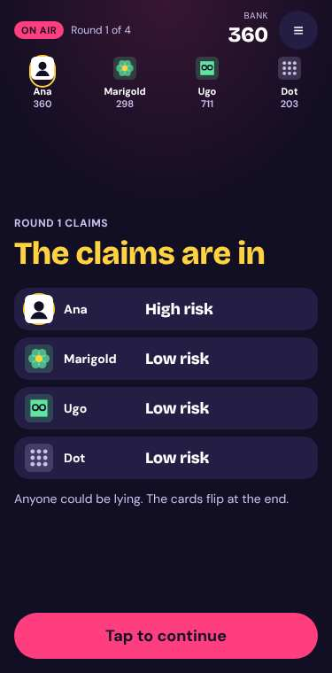 | 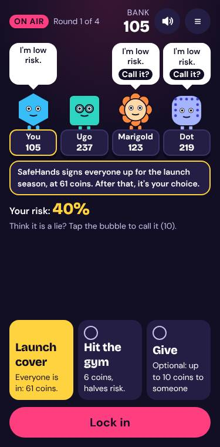 |
| Episode 3 wheel (spinning, then result) | 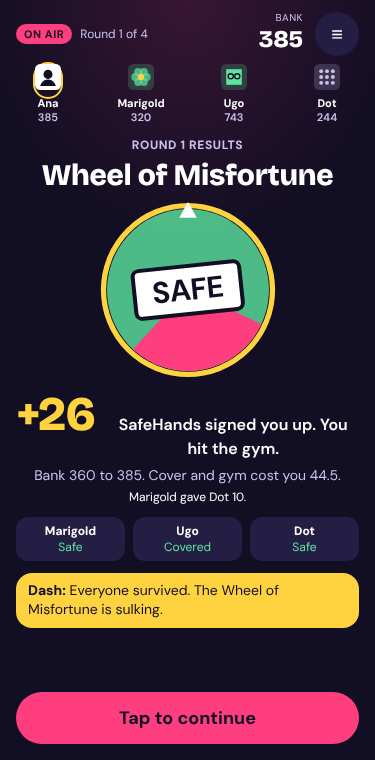 | 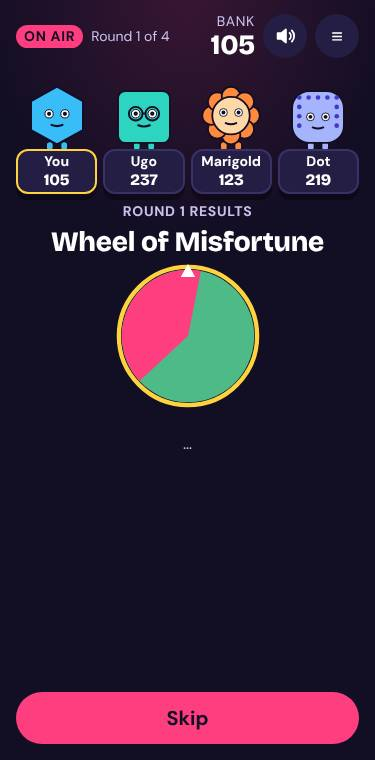 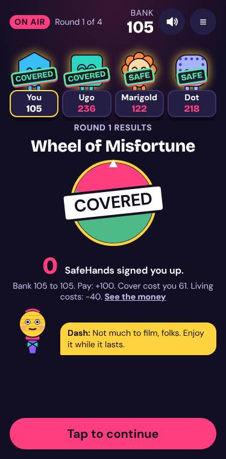 |
| Episode 4 HireBot judge | 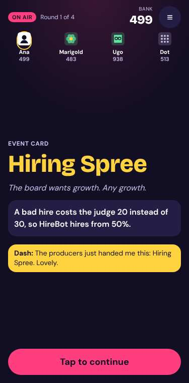 | 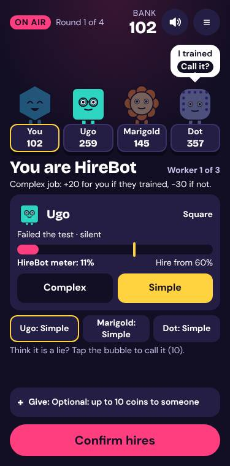 |
| Episode 5 ballots | 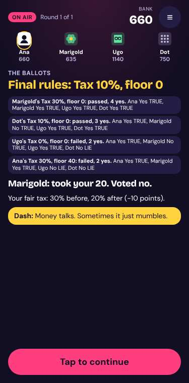 | 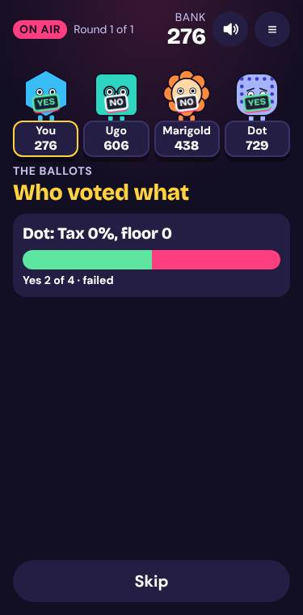 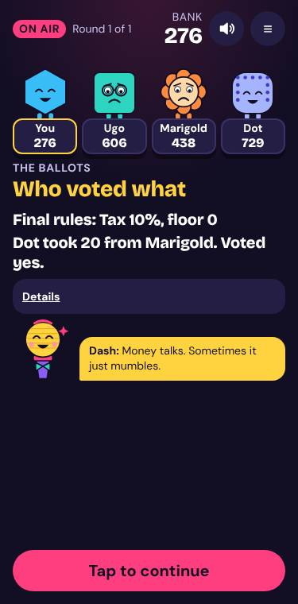 |

Also: the Bar with a barred contestant, 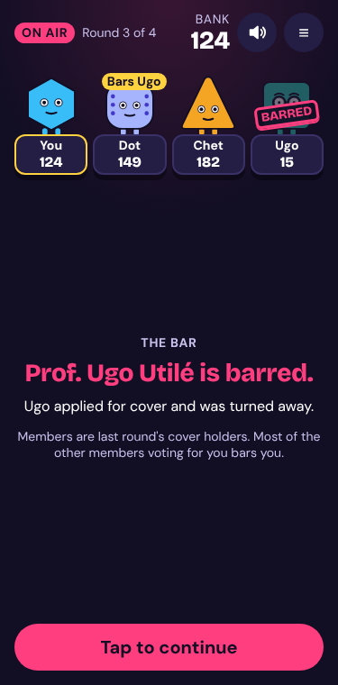.

Note: the AFTER captures were taken before the cycle 3 fixes (the last round of headline and stamp changes).
